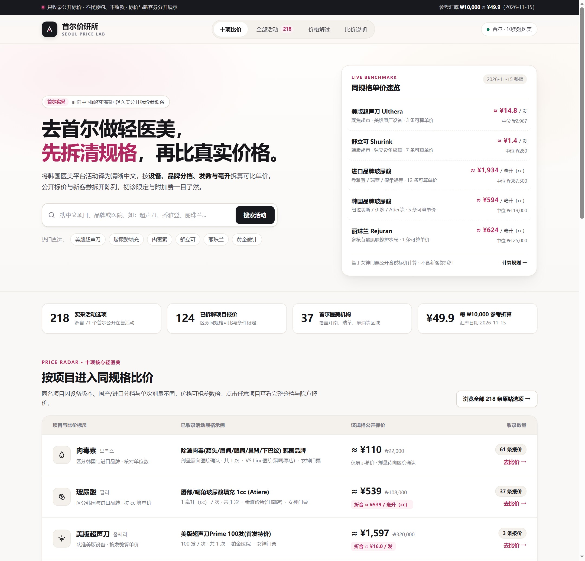
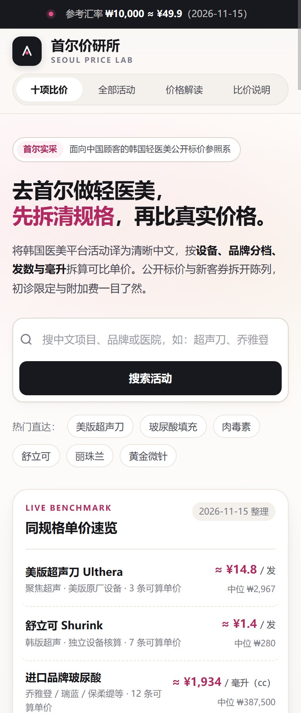

# 首尔价研所 · Seoul Beauty Price

[](LICENSE)
[](pyproject.toml)
[](web/package.json)

面向中国顾客的**韩国首尔皮肤科轻医美公开活动结构化比价看板与合规采集管线**。  
只做首尔地区十类轻医美公开活动规格拆解与同规格单价对比，**不做医疗机构排名、不代预约、不收佣金、不捏造“官方指导价”**。

| 桌面端比价总览 | 移动端响应式视图（390px） |
| :---: | :---: |
|  |  |

---

## 核心特性

- **十类轻医美同规格拆解**：覆盖肉毒素（Botox）、玻尿酸（Filler）、美版超声刀（Ulthera）、热玛吉（Thermage）、舒立可（Shurink）、丽珠兰（Rejuran）、水光（Skin Booster）、皮秒（Pico）、InMode 射频与黄金微针（Potenza）。
- **确定性代码计价与分区**：含税换算、单次剂量单位价（每发 / 每 cc / 每单位）、分桶分位数（`P25` / 中位 / `P75`）、人民币与韩元双币展示全部由确定性代码计算；复杂套餐、附加条件项（仅限初诊/工作日/需评价等）与规格待确认项严格分区，模型无权干预价格或排序。
- **中韩双语可溯源核对**：面向中国顾客优先展示中文项目名、人民币参考总价/单价与首尔行政区（江南区、瑞草区、麻浦区等），每张卡片保留韩文原名、机构原名、基础价 vs 券后价及原站直达链接，支持一键复制韩文项目与地址到院核对。
- **严格合规采集护栏**：
  - 强制遵守 `robots.txt` 与 `Crawl-delay`（robots 获取失败直接停采，不降级放行）；
  - 具名 `User-Agent`、单并发固定间隔（Yeoshin ≥ 5s，Babitalk ≥ 3s），禁止代理轮换、登录绕过或验证码破解；遇到 `403 / 429 / 验证码` 当日自动熔断；
  - 原始 HTML 仅驻留内存解析，落盘快照仅为 `fact_projection_v1` 允许事实 JSON，**不采集、不存储患者评价、昵称、照片或医生个人信息**；
  - 江南姐姐（Unni）因 `robots.txt` 对常规爬虫声明 `Disallow: /`，仅保留禁用接口槽位与回归测试，绝不伪装搜索引擎抓取。
- **受限只读 AI 辅助层**：
  - **结构化抽取与校验**：Pydantic 强约束 schema + 词典归一化 + 证据字段核验；
  - **展示层中文化缓存**：`localized_texts` 强校验数字 token 多重集合不变（防止翻译篡改发数/容量/次数）；
  - **SQLite 只读分析代理**：通过 SQLite Authorizer 限制单条 `SELECT`、仅允许访问三张脱敏统计视图、最多 200 行与 5 秒 VM 超时。

---

## 仓库结构

```text
.
├── dictionary/procedures.yaml   # 十类轻医美项目、品牌分档与韩英中别名词典
├── migrations/                  # SQLite 迁移脚本（含 SHA256 完整性校验）
├── pipeline/                    # Python 3.12 核心管线
│   ├── sources/                 # Sitemap 发现、robots 守卫、Yeoshin/Babitalk 适配器、Unni 禁用槽位
│   ├── extract/                 # 规则抽取、Gemini 结构化抽取、Batch 接口与 100 条金标评估器
│   ├── pricing.py               # 含税归一化、同规格分桶、单位价与分位数计算
│   ├── localize.py              # 韩中展示层翻译缓存与数字不变性校验
│   ├── analyst/                 # OpenAI-compatible / Gemini 只读 SQL 分析代理与日报校验
│   └── publish.py               # 前端白名单 JSON 导出、参考汇率更新与原子发布
├── scripts/                     # 有界实页核验、扩采导入、翻译预览与分析草稿脚本
├── web/                         # Astro 7 + Tailwind CSS v4 静态比价前端
├── deploy/                      # Caddy、systemd 定时服务与 Litestream 备份配置模板
├── tests/                       # 165 项离线单元测试与合成/脱敏投影测试夹具
├── HANDOFF.md                   # 原始产品与工程边界规范
└── AI_HANDOFF.md                # 工程进度、实采快照与后续开发交接说明
```

---

## 快速开始

### 1. 安装后端环境与运行测试

要求 **Python 3.12** 与 [uv](https://docs.astral.sh/uv/)：

```bash
uv sync --frozen --extra dev
uv run pipeline migrate
uv run pipeline run
uv run ruff check .
uv run pytest -q
```

> 说明：克隆仓库后默认不包含本地 SQLite 数据库（`data/`）与 `.env` 私密配置。`pipeline run` 默认执行零网络、零模型调用的 8 阶段空流程骨架校验；携带 `--live` 时才会执行受门禁保护的真实阶段。

### 2. 启动前端静态站点预览

要求 **Node.js 20+** 与 npm：

```bash
cd web
npm ci
npm run dev -- --port 4321
```

浏览器打开 `http://127.0.0.1:4321/`。当 `web/src/data/generated.json` 未生成时，前端自动回退为空库安全模式（`mode: "empty"`）并可正常完成静态构建（`npm run build`）；导入实采数据并执行投影后将自动生成完整项目页、机构页与活动库。

---

## CLI 命令参考

| 命令 | 说明 |
| --- | --- |
| `pipeline migrate` | 校验已执行迁移的 SHA256 并应用新增 SQLite 迁移 |
| `pipeline run` | 按顺序运行 `discover → collect → prefilter → extract → validate → calculate → build → analyst` 空流程骨架 |
| `pipeline run --live` | 执行真实业务流水线（受 `PIPELINE_SITE_URL`、KST 凌晨时间窗、预算费率等门禁保护） |
| `pipeline step <name> [--live]` | 单独执行指定阶段 |
| `pipeline analyst-check` | 执行一次最小化分析网关连通性与 JSON 响应校验 |
| `pipeline batch-submit` / `batch-poll <name>` | 提交或轮询原生 Gemini Batch 抽取任务 |
| `pipeline export-unlabeled --output <path>` | 从数据库导出 100 条真实未标注样本供人工金标标注 |
| `pipeline evaluate <gold.jsonl> <pred.jsonl>` | 独立评估 `procedure / brand / quantity+unit / vat` 四字段准确率 |

---

## 环境配置

复制 `.env.example` 为 `.env` 并按需填写（**切勿提交真实 `.env` 或任何 API 密钥**）：

- `PIPELINE_SITE_URL`：正式采集必填的公开站点 URL（用于拼接合规具名 `User-Agent`）。
- `GEMINI_API_KEY` / `MODEL_EXTRACT` / `MODEL_EXTRACT_RETRY`：结构化抽取模型配置。
- `PIPELINE_ANALYST_PROVIDER` / `PIPELINE_ANALYST_BASE_URL` / `ANALYST_API_KEY` / `MODEL_ANALYST`：只读分析代理配置（支持 `google_genai` 或 `openai_compatible` HTTPS 网关）。
- `PIPELINE_AI_INPUT_USD_PER_MILLION` / `PIPELINE_AI_OUTPUT_USD_PER_MILLION`：供应商实核费率；未配置时自动付费任务保持 fail-closed。

---

## 当前工程进度

- **已完成**：M0 工程底座、SQLite 迁移与只读安全视图、Yeoshin（女神门票）公开内嵌 JSON 解析器与有界实采链路、保守规则归一化与确定性单价/分位数计算、韩中双语展示层（含数字不变性校验）、Astro 全套响应式中文比价前端及 165 项离线回归测试。
- **待推进**：Babitalk 实页可购买选项 DOM 适配验收、100 条人工金标标注与 M2 95% 准确率核验、更多 InMode 等少样本品类扩采、生产域名与 KST 定时任务实机上线（详见 [AI_HANDOFF.md](AI_HANDOFF.md) 与 [HANDOFF.md](HANDOFF.md)）。

---

## 免责声明与开源许可

- 本项目仅提供公开商业活动价格的结构化整理技术与比价视图参考，**不构成任何医疗建议、诊断或机构推荐**。实际施术资格、是否含 10% 附加税（VAT）、外国游客退税及具体适应症请务必在到院前与医疗机构核实韩文原文条款。
- 本仓库基于 [MIT License](LICENSE) 开源。
